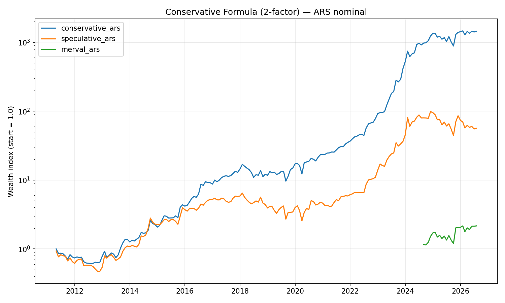
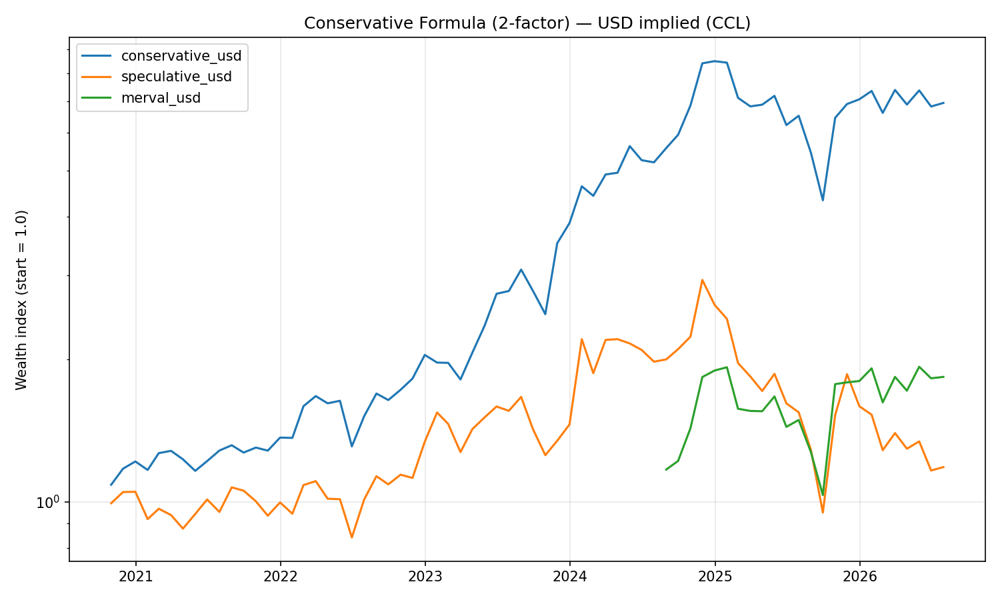

# The Conservative Formula — Argentina (BYMA)

Tests whether ["The Conservative Formula" (Van Vliet & Blitz, 2018)](ssrn-3145152.pdf)
holds on the Argentine equity market, using the
[Portfolio Personal de Inversiones (PPI) API](https://itatppi.github.io/ppi-official-api-docs/)
for market data.

## What the paper says

Select the top 100 of the largest 1,000 US stocks based on: low 3-year return
volatility, high Net Payout Yield (dividend yield + net buyback yield), and
strong 12-1 month price momentum. Equal-weight, rebalance quarterly. The
paper finds this beats the market by a wide margin, with lower risk, in the
US, Europe, Japan, and Emerging Markets.

## What this project does differently, and why

PPI's API does not expose two things the original methodology needs:

- **No bulk instrument-listing endpoint** — only search-by-ticker. So the
  Argentine universe (`config/universe.csv`, ~65 BYMA-listed common stocks —
  Panel Líder + Panel General) is a curated static list, not pulled live.
- **No dividends/buybacks/corporate-actions endpoint** — so **Net Payout
  Yield is dropped for now**. This is a **2-factor "Low-Vol + Momentum"**
  version of the formula. `src/formula/factors.py::compute_npy` is a stub
  ready to wire in a dividends CSV once one exists — nothing else needs to
  change when it does.
- **No historical FX endpoint** — implied ARS/USD (CCL) rates are derived
  from ARS-vs-USD-settled bond pairs (`AL30`/`AL30D`, `GD30`/`GD30D`) rather
  than a dedicated FX series. Results are reported in both nominal ARS and
  USD-implied terms, since Argentina's inflation/devaluation history makes
  nominal ARS returns hard to compare with the paper's US/Europe/Japan/EM
  figures (all reported in USD).

On dividend data (for a future 3-factor version): Argentine stocks pay
low/lumpy dividends historically — BCRA profit-repatriation and dividend
restrictions during capital-control periods caused many companies to skip
payouts for years — so NPY may matter less here than in the US sample, but
it's still worth adding. Refinitiv/Eikon (if you have access) is the
closest match to the paper's Factset-grade data (full dividend + shares-
outstanding history). Lighter free alternatives: Yahoo Finance `.BA`
tickers (inconsistent coverage/adjustments for Argentine names) or CNV's
"Hechos Relevantes" corporate-action filings as a primary-source fallback.
Whichever you use, drop it into `data/manual/dividends.csv` following
`data/manual/dividends_template.csv`'s columns.

## Results (2010–2026 backtest, 63 BYMA stocks)

Live run against PPI, 2-factor (Low-Vol + Momentum) formula, quarterly
rebalance. **Conservative** = low-vol half of the universe, top ~30% by
12-1 month momentum. **Speculative** = high-vol half, worst momentum —
the paper's long-short comparison portfolio, not something to actually hold.
Full numbers in [`reports/performance_summary.csv`](reports/performance_summary.csv).

### Nominal ARS (Jan 2011 – Jul 2026, 184 months)

| Portfolio | CAGR | Ann. Vol | Sharpe | Max Drawdown | Total return |
|---|---|---|---|---|---|
| **Conservative** | 60.7% | 44.3% | 1.29 | -43.0% | ~1,444x |
| Speculative | 30.1% | 50.4% | 0.75 | -60.4% | ~56x |
| Merval (index, last ~2y only*) | 47.0% | 61.0% | 0.88 | -30.9% | ~2.2x |



### USD-implied via CCL (Oct 2020 – Jul 2026, 70 months — as far back as the AL30/GD30 bond pairs go)

| Portfolio | CAGR | Ann. Vol | Sharpe | Max Drawdown | Total return |
|---|---|---|---|---|---|
| **Conservative** | 39.4% | 40.5% | 1.01 | -49.1% | ~6.9x |
| Speculative | 2.9% | 50.1% | 0.28 | -67.7% | ~1.2x |
| Merval (index, last ~2y only*) | 35.4% | 64.5% | 0.73 | -46.2% | ~1.8x |



**Takeaway:** directionally, the paper's core finding replicates — the
low-vol/momentum sleeve beats its opposite by a wide margin, with a
meaningfully smaller drawdown, in both nominal ARS and USD-implied terms.

**Caveats before reading too much into this:**
- NPY isn't in the ranking yet (see above) — this is testing 2 of the
  paper's 3 factors.
- *The Merval benchmark comes from BYMA's free public endpoint, which
  silently caps history at ~2 years regardless of the requested range —
  it's shown for the overlapping window only, not the full backtest.
- USD-implied returns only go back to late 2020 because the AL30/GD30
  dollar-linked bonds used for the CCL proxy didn't exist before that
  year's debt restructuring.
- 63 stocks (many illiquid "Panel General" small-caps) is a much thinner
  and noisier universe than the paper's 1,000 large-cap US stocks — treat
  this as a suggestive first look, not a robust replication.

Regenerate these with `python -m src.backtest.run_backtest --start 2010-01-01`
then `python -m src.backtest.report` (see below).

## Setup

```bash
pip install -r requirements.txt
cp .env.example .env
# then edit .env with your real PPI_PUBLIC_KEY / PPI_PRIVATE_KEY
# (PPI account -> "Gestiones" -> activate API service)
```

`.env` is gitignored — real credentials never get committed.

## Running the pipeline

```bash
# 1. Sanity-check the universe resolves against PPI
python -m src.data_sources.universe

# 2. Pull history, build the Conservative/Speculative portfolios, compute
#    ARS + USD-implied return series
python -m src.backtest.run_backtest --start 2015-01-01

# 3. Performance summary (CAGR, Sharpe, max drawdown, vol) + equity-curve plots,
#    for Conservative vs Speculative vs Merval, in both currencies
python -m src.backtest.report
```

Outputs land in `data/processed/` (gitignored — regenerate anytime by
re-running the pipeline): `portfolio_returns.csv`, `holdings.json`,
`performance_summary.csv`, `equity_curve_ars.png`, `equity_curve_usd.png`.

## Tests

```bash
pytest tests/
```

Unit tests run on synthetic data only — no PPI credentials required.

## Project layout

```
config/universe.csv           # curated Argentine stock universe (ticker, name, panel, sector)
reports/                      # committed snapshot backing the Results section above
  performance_summary.csv, equity_curve_ars.png, equity_curve_usd.png
data/
  raw/                        # gitignored — cached PPI historical pulls
  processed/                  # gitignored — factor scores, returns, reports, plots
  manual/dividends_template.csv  # expected columns for a future NPY dividends CSV
src/
  config.py                   # paths, PPI credentials (.env), formula parameters
  data_sources/
    ppi_client.py             # PPI SDK wrapper (auth, historical search, caching)
    universe.py                # loads + validates config/universe.csv against PPI
    fx.py                      # implied ARS/USD from dollar-linked bond pairs
    benchmark.py                # S&P Merval index history (BYMA public API)
  formula/
    factors.py                 # trailing volatility, 12-1 momentum, NPY stub
    portfolio.py                # low-vol/momentum ranking -> Conservative/Speculative portfolios
  backtest/
    run_backtest.py             # end-to-end pipeline
    report.py                   # performance metrics (via the `backtesting` skill's ratios.py) + plots
tests/test_factors.py          # unit tests on synthetic data
```
